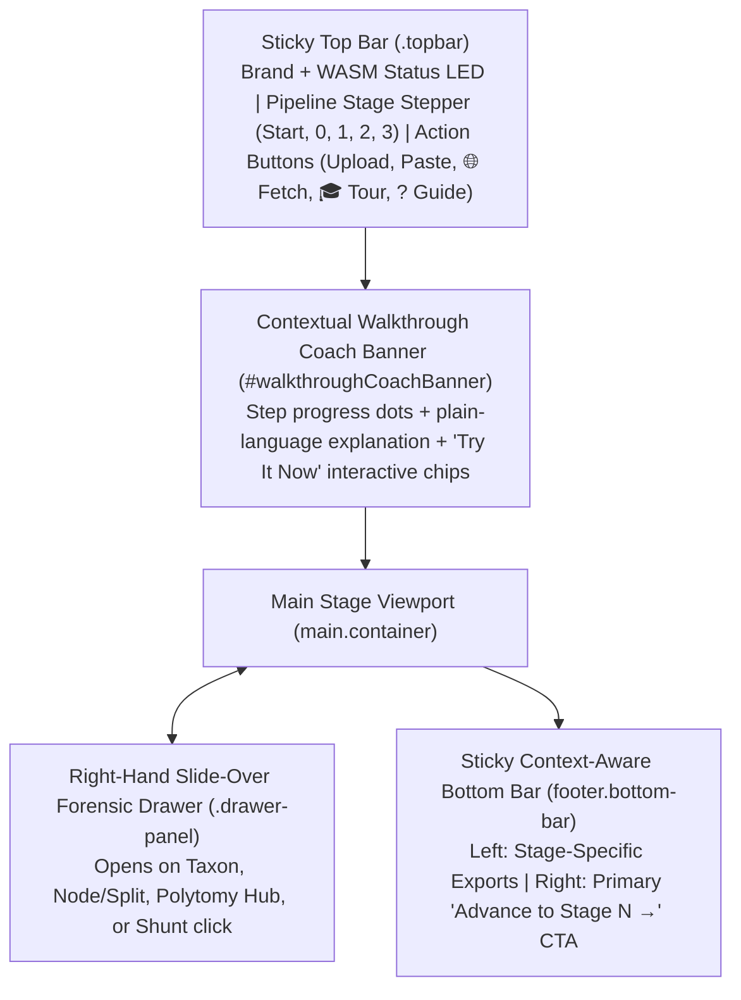

# Web Application Design System & UI/UX Specification for Phylogenetic Tree & Graph Induction (`BUSHWHACKER` / `trees`)

**Status:** Production Blueprint (`v1.0`)  
**Target Repository:** `/Users/sergei/Projects/trees` (`docs/index.html`)  
**Reference Implementation:** HyPhy 3 / WALRUS Web Workbench (`/Users/sergei/Development/hyphy-3/web/index.html`)

---

## 1. Core Design Philosophy & Aesthetic Principles

The application follows a **Dieter Rams / Braun Industrial Functionalist** and **Warm-Ivory Editorial Workbench** aesthetic. Phylogenetic and evolutionary graph inference produces high-dimensional combinatorial objects (topologies, branch lengths, multifurcating polytomy hubs, recombinant intervals, convergent site shunts, and information-theoretic code lengths). The UI must make these objects **immediately legible to a first-time biologist in under 10 seconds**, while preserving **full mathematical and site-level auditability** for power users.

### Ten Governing UX Rules
1. **Verdict First, Evidence on Demand (Progressive Disclosure):** Every stage begins with a single plain-language **Hero Verdict Card** summarizing *what was found* and *why it matters*, accompanied by 4–6 key tabular KPI blocks. Detailed site lists, combinadic bit/nat ledgers, and mutation tables live in slide-over **Forensic Inspector Drawers** opened on click.
2. **Explicit Multi-Stage Pipeline Mental Model:** Even when an algorithm runs end-to-end in 100 milliseconds, users understand evolutionary inference better when decomposed into inspectable stages (`⌂ Start` $\to$ `0 QA & Site Coherence` $\to$ `1 Tree & Polytomy Induction` $\to$ `2 Reticulate Shunts & Forensics` $\to$ `3 Dossier & Export`), paired with a **Step-by-Step vs. ⚡ Full Auto** launch mode.
3. **Zero-Friction Data Ingestion:** Users must be able to launch an analysis in one click via:
   - Curated biological showcase cards,
   - Drag-and-drop local files (`.fasta`, `.phy`, `.nex`, `.nwk`, `.json`),
   - Raw clipboard paste, or
   - **Live Browser Streaming (`🌐 Fetch`)** directly from **NCBI Entrez Gene Orthologs**, **GenBank/RefSeq/ENA accessions**, or **GitHub/Zenodo URLs**.
4. **Built-In Interactive Guided Walkthrough (`🎓 Tour`):** First-time visitors can click a guided tour that loads a real empirical cohort and displays a stage-aware **Coach Banner** with one-click *"Try It Now"* chips that highlight specific nodes, polytomy hubs, or convergent shunts.
5. **Deterministic State Flushing:** Starting a new analysis or changing an upstream parameter (e.g., toggling coding 3rd-position weighting or excluding a rogue taxon in Stage 0) **must immediately flush all downstream stage states, badges, and drawers** so stale results from a previous dataset can never mix with current results.
6. **Pre-Flight Compute & Memory Gate:** Before launching heavy jobs in WebAssembly, inspect $(N, L)$ and warn the user only when empirical complexity formulas predict significant wait time ($>60\text{ s}$) or high WASM heap pressure ($>1.2\text{ GB}$), offering concrete mitigation options.
7. **Linked Multi-Scale Views:** Clicking a branch, polytomy hub, or reticulate shunt in the tree canvas highlights its supporting sites in the **Genome-Wide Barcode Track** and opens its **MDL Ledger Drawer**; clicking a site in the barcode track highlights the branches carrying mutations at that site.
8. **Overflow-Proof Responsive Chrome:** The top navigation bar, stage stepper, action buttons, canvases, and drawers must never cause horizontal viewport overflow (`max-width: 100vw; overflow-x: hidden`) from `390px` mobile screens up to `2560px+` ultrawide monitors.
9. **100% Client-Side Privacy & Reproducibility:** All sequence parsing, bit-plane SIMD tree induction, and rendering execute locally in WebAssembly/Web Workers. Every stage provides one-click exports of clean FASTA, Newick (with MDL support & branch lengths), NEXUS, JSON audit ledgers, and vector SVG figures.
10. **Strict Scientific Integrity:** Never display synthetic placeholders or hardcoded curves; every number, branch support, and site pill in the UI must be computed directly from the active dataset by the underlying Rust/C++ WASM engine.

---

## 2. Visual Design Tokens & Typography

### 2.1 Color System (CSS Custom Properties)

Use a warm paper/ivory background to eliminate the eye strain of pure `#FFFFFF` or pitch-black dark mode during long inspection sessions, paired with high-contrast ink and semantic status colors:

```css
:root {
  /* Surfaces */
  --bg:            #F6F5F1; /* Warm ivory workbench canvas */
  --bg-card:       #FFFFFF; /* Elevated card surface */
  --bg-subtle:     #EFECE6; /* Recessed toolbar / pill container */
  --bg-hover:      #E6E2DA; /* Interactive row/button hover */

  /* Borders */
  --border:        #DFDCD4; /* Primary card & control border */
  --border-subtle: #EAE7DF; /* Internal table/row hairline */
  --border-strong: #9C9A94; /* Active/focused control border */

  /* Ink Hierarchy */
  --ink:           #141413; /* Primary headings, active labels, data values */
  --ink-secondary: #4A4945; /* Body copy, secondary descriptions */
  --ink-muted:     #787670; /* Captions, axis labels, inactive states */

  /* Primary Brand & Action Accent (Braun Signal Orange) */
  --orange:        #E04F16;
  --orange-hover:  #C8430F;
  --orange-soft:   #FDF0EA;

  /* Semantic Evolutionary Status Palette */
  --green:         #18794E; /* Certified split / Admitted taxon / Compression gain */
  --green-bg:      #E9F6EF;
  --green-border:  #B4E2C9;

  --blue:          #1D4ED8; /* INTERVAL recombination shunt / Structural partition */
  --blue-bg:       #EFF6FF;
  --blue-border:   #BFDBFE;

  --amber:         #B45309; /* Polytomy hub (d >= 4) / Frame rescue / Caution */
  --amber-bg:      #FEF6E7;
  --amber-border:  #F7D9A4;

  --purple:        #6D28D9; /* SPARSE convergent shunt / Epistatic coupling */
  --purple-bg:     #F5F3FF;
  --purple-border: #DDD6FE;

  --danger:        #B91C1C; /* Quarantined taxon / High-gap outlier / Error */
  --danger-bg:     #FEF2F2;
  --danger-border: #FECACA;

  /* Typography */
  --font-sans: -apple-system, BlinkMacSystemFont, "Inter", "Segoe UI", Roboto, sans-serif;
  --font-mono: "JetBrains Mono", "SF Mono", ui-monospace, Menlo, Consolas, monospace;
}
```

### 2.2 Typographic Scale & Numeric Discipline
- **All numeric metrics, coordinates, branch lengths, MDL code lengths (nats), and taxon accessions MUST use `var(--font-mono)` with `font-variant-numeric: tabular-nums`** so columns and live counters never jitter.
- **Stage Hero Title:** `17px–19px`, `font-weight: 700`, `letter-spacing: -0.015em`.
- **KPI Metric Value (`.metric-num`):** `24px`, `font-family: var(--font-mono)`, `font-weight: 700`.
- **KPI Metric Caption (`.metric-caption`):** `11.5px`, uppercase, `letter-spacing: 0.04em`, `color: var(--ink-muted)`.
- **Badges & Pills (`.badge`):** `11.5px`, `font-family: var(--font-mono)`, `font-weight: 600`, `padding: 3px 8px`, `border-radius: 999px`.

---

## 3. Global Application Chrome & Layout Architecture



### 3.1 Overflow-Proof Sticky Top Bar (`.topbar`)
The top bar is persistent across all views (`position: sticky; top: 0; z-index: 50`) and contains three zones:
1. **Left — Brand & Live Engine Status (`.brand`):**
   - Clickable logo/title (`BUSHWHACKER` or `TREES`) returning to `⌂ Start`.
   - Status LED dot (`.status-dot`: amber while booting WASM, green when idle/ready, pulsing orange when running).
   - Compact status string (`.brand-status`, capped at `max-width: 165px; overflow: hidden; text-overflow: ellipsis; white-space: nowrap`), e.g., `Engine Ready`, `⚡ Running Stage 1…`, or `Ready • 3/3 Done`.
2. **Center — Live Pipeline Stage Stepper (`nav.stage-steps`):**
   - `⌂ Start` — Launchpad, Live Streamer, Guided Tours, Pre-Built Examples
   - `0 QA` — Alignment & Site Coherence QA (shows badge e.g. `116 taxa` or `12ms`)
   - `1 Tree` — MDL Tree & Polytomy Induction (shows badge e.g. `95 splits` or `98ms`)
   - `2 Shunts` — Reticulate Shunts & MDL Forensics (shows badge e.g. `1 shunt` or `24ms`)
   - `3 Dossier` — Standalone Report & Publication Exports
   - Each step button has 4 visual states: `pending`, `running` (animated spinner ring), `done` (`✓` + runtime), and `active` (high-contrast dark pill `#141413` with orange step badge).
3. **Right — Global Utility Actions (`.topbar-actions`):**
   - Concise button labels so the bar never overflows:
     - `Upload` (triggers hidden `<input type="file">`)
     - `Paste` (opens `#pasteModal`)
     - `🌐 Fetch` (opens `#streamModal` for NCBI GenBank / RefSeq / ENA / URL streaming)
     - `🎓 Tour` (toggles the interactive guided walkthrough)
     - `? Guide` (opens the slide-over documentation, MDL math primer, & FAQ drawer)

#### Top Bar Responsive Breakpoint Contract
- **`> 1260px` (Desktop & Widescreen Laptop):** Single-row layout (`flex-wrap: nowrap`). `.stage-steps` has `flex: 0 1 auto; min-width: 0; overflow-x: auto;` while `.brand` and `.topbar-actions` have `flex-shrink: 0`.
- **`<= 1260px` (Compact Laptop & Tablet):** Two-row layout (`flex-wrap: wrap`):
  - **Row 1:** `.brand` (`order: 1`) on the left + `.topbar-actions` (`order: 2; margin-left: auto`) on the right.
  - **Row 2:** `.stage-steps` (`order: 3; width: 100%; flex: 1 1 100%; overflow-x: auto; border-top: 1px solid var(--border-subtle); padding-top: 8px;`).
- **`<= 720px` (Mobile):** `.brand-status` hides (`display: none`) so `● BRAND` and the 5 compact action buttons (`Upload`, `Paste`, `🌐 Fetch`, `🎓 Tour`, `? Guide`) fit cleanly on Row 1 inside a `390px–500px` viewport without horizontal page overflow.

---

## 4. Landing Launchpad (`#landingView`)

When the user first lands on the page, they see a clean, uncrowded launchpad (and the sticky bottom bar is hidden):

### 4.1 Hero Split Card (`.landing-hero`)
- **Left Column:**
  - Kicker badge: `RUST + SIMD128 WEBASSEMBLY WORKBENCH`
  - Headline: Clear 1-sentence value proposition (e.g., *Minimum Description Length Phylogenetic Tree, Polytomy & Reticulate Shunt Induction*).
  - **Launch Mode Selector (`.mode-switch-options`):**
    1. **Step-by-Step Workbench** — Inspect Stage 0 alignment/site QA first, then advance stage-by-stage.
    2. **⚡ Full Auto Pipeline** *(default for 1-click demos)* — Chain `Stage 0 → Stage 1 → Stage 2` automatically and land directly on the induced tree & network canvas.
- **Right Column — Interactive Dropzone (`.dropzone-box`):**
  - Drag-and-drop target accepting `.fasta`, `.fa`, `.fna`, `.phy`, `.phylip`, `.nex`, `.nexus`, `.nwk`, `.tre`, and `.json`.
  - Three primary action buttons inside the dropzone:
    - `Choose File…` (primary orange button)
    - `Paste Alignment / Newick`
    - `🌐 Stream from GenBank / URL`

### 4.2 Interactive First-Time Walkthrough Card (`.walkthrough-landing-card`)
Positioned directly below the Hero card:
- Displays a 4-column visual summary of the pipeline stages (`Stage 0: Site & Taxon QA`, `Stage 1: Zero-Bootstrap Tree & Polytomies`, `Stage 2: Reticulate Shunt Peeling`, `Stage 3: MDL Ledger & Exports`).
- Provides **3 one-click Guided Tour launch buttons**:
  1. `▶ Start Guided Tour: Convergent Echolocation Shunt (Mammalian Prestin, N=116)`
  2. `▶ Tour Zero-FPR Polytomy Calibration (Adaptive Radiation, N=64)`
  3. `▶ Tour Recombination Interval Shunt (Mosaic HGT Cohort, N=24)`

### 4.3 Curated Biological Showcase Grid (`.examples-grid`)
Each pre-loaded dataset card is structured around a **biological story and analytical failure mode solved by the engine**, never just a raw filename:
- **Header:** Category pill (e.g., `CONVERGENT EVOLUTION`, `HARD POLYTOMY`, `FELSENSTEIN LBA TRAP`, `MOSAIC RECOMBINATION`) + Taxa/Sites monospace badge (`116 taxa × 2,235 bp`).
- **Title & Narrative:** 2-sentence explanation of the biological dataset and what standard ML/bootstrap trees get wrong vs. what MDL graph induction reveals.
- **Expected Discovery Callout:** Monospace pill showing the exact expected finding (e.g., `SPARSE Shunt N140 ↔ N167 (+4.94 nats, codons 7, 384, 392, 601)`).
- **Dual Launch Buttons:** `Step-by-Step` (secondary) and `⚡ Full Auto` (primary).

---

## 5. Live Public-Datasource Sequence Streamer (`#streamModal` — `🌐 Fetch`)

Allows users to build trees directly from public repositories in ~1.5 seconds over browser HTTPS CORS without leaving the app:

### Tab 1: NCBI Gene Ortholog Cohort Streamer (`orthologs`)
- **Inputs:**
  - `Gene Symbol` (e.g., `SLC26A5` / `Prestin`, `RHO`, `IFITM3`, `BST2`, `ACE2`, `BRCA1`)
  - `Taxonomic Clade` dropdown (`Mammalia`, `Primates`, `Chiroptera`, `Carnivora`, `Rodentia`, `Cetartiodactyla`, `Aves`, `Actinopterygii`, `Vertebrata`, `Arthropoda`, `Coronaviridae`)
  - `Max Species` selector (`16`, `32`, `64`, `120` taxa)
  - Checkbox: *Prefer curated NCBI RefSeq (`NM_` / `XM_`) and deduplicate to 1 coding sequence per species*.
- **One-Click Preset Chips:** *Mammalian Prestin (SLC26A5)*, *Vertebrate Rhodopsin (RHO)*, *Mammalian IFITM3*, *Bat Tetherin (BST2)*, *Primate APOBEC3G*.
- **Client-Side Pipeline:**
  1. Queries NCBI Entrez `esearch.fcgi?db=nuccore&retmode=json` for matching mRNA/CDS records.
  2. Queries `esummary.fcgi?db=nuccore&retmode=json` to resolve `organism` and `accessionversion`, prioritizing `NM_` over `XM_` and deduplicating to **1 record per species**.
  3. Streams coding sequences via `efetch.fcgi?db=nuccore&rettype=fasta_cds_na&retmode=text`, selects the target gene CDS feature, rewrites clean `>Genus_species_Accession` headers, and feeds the cohort into Stage 0.
  4. *(Optional in-browser alignment hook)*: If streamed sequences are unaligned CDS of varying lengths, automatically runs banded codon/nucleotide POA alignment (or prompts to align) before tree induction.

### Tab 2: GenBank / RefSeq / EMBL-EBI ENA Accessions (`accessions`)
- Repository selector (`NCBI Coding CDS fasta_cds_na`, `NCBI Full Nucleotide FASTA`, `EMBL-EBI ENA FASTA`) + textarea for comma/newline-separated accession IDs + `"Load Sample Accessions"` chip.

### Tab 3: Remote URL / GitHub / Zenodo (`url`)
- Fetches any CORS-enabled `.fasta`, `.phy`, `.nex`, `.nwk`, or `.json` file over HTTPS. Automatically rewrites `https://github.com/<org>/<repo>/blob/<branch>/<path>` to `https://raw.githubusercontent.com/<org>/<repo>/<branch>/<path>`.

---

## 6. Stage-by-Stage Workbench Specifications

### 6.1 Stage 0: Alignment, Taxon & Site Coherence QA (`#stage0View`)
Before inducing a tree, give the user a clear diagnostic view of the input alignment or Newick tree:
- **Hero Verdict Card:**
  - Verdict headline (e.g., *"116 Taxa × 2,235 nt Admitted — 742 Parsimony-Informative Sites (Coding 3rd-Position Downweighting Active)"*).
  - 5 KPI Metric Blocks:
    1. `Admitted Taxa` ($N$, plus count of flagged high-gap/duplicate sequences)
    2. `Alignment Length` ($L\text{ bp}$ / $L/3\text{ codons}$)
    3. `Effective Informative Sites` ($L_{\text{eff}}$ & mean site compatibility $C(x_i)$)
    4. `Star Tree Null MDL` ($L_{\text{star}}$ in nats — the 0-split baseline)
    5. `Data Regime` (`Coding CDS Auto-Detected` vs. `Non-Coding Nucleotide` vs. `Newick Tree Only`)
- **Interactive Controls Bar:**
  - Toggle: `Coding 3rd-Position Entropy Weighting` (`Auto` / `On` / `Off`) — changing this immediately re-runs Stage 0 and flushes Stages 1–3.
  - Toggle: `Deduplicate Identical Sequences` (`Collapse to 1 representative` vs. `Keep all`).
  - Filter pills for the Taxon Table: `All Taxa`, `Admitted`, `High Gap / Ambiguous (>50% N/-)`, `Identical Duplicates`.
- **Site Coherence & Entropy Horizon Strip:**
  - Compact SVG/Canvas sparkline across $[1, L]$ showing per-site Four-Gamete compatibility $C(x_i)$ and gap fraction so gappy/unaligned regions or hypervariable domains are immediately visible.
- **Taxon QA Ledger Table:**
  - Columns: Checkbox (include/exclude taxon), Taxon Name (with automatic UCSC/NCBI common-name translation badge, e.g., `HLturTru3` $\to$ `Bottlenose dolphin`), Unambiguous Length, Gap/Ambiguity %, Terminal Branch Load estimate, Status Badge (`Admitted`, `High-Gap Warning`, `Duplicate`).
  - Clicking any row opens the **Stage 0 Taxon Inspector Drawer** showing sequence composition (GC%, A/C/G/T counts, gap map) and nearest-neighbor hamming/JC69 distances.

### 6.2 Stage 1: MDL Tree & Polytomy Induction (`#stage1View`)
The centerpiece interactive tree workbench:
- **Hero Verdict Card:**
  - Headline summarizing topological resolution and MDL compression (e.g., *"Resolved 95 Binary Splits & 12 Polytomy Hubs — 45.3% MDL Compression vs. Star Null (43,812.9 vs. 80,036.0 nats)"*).
  - 5 KPI Metric Blocks:
    1. `Tree MDL Code Length` ($L(T_0, X)$ in nats + `% of Star Null`)
    2. `Net MDL Savings` ($\Delta L = L_{\text{star}} - L(T_0, X)$ in nats)
    3. `Resolved Binary Splits` (e.g., `95 / 113`)
    4. `Calibrated Polytomy Hubs` (count of multifurcations $d \ge 4$ where further splitting had $\Delta L \le 0$)
    5. `Compute Runtime` (e.g., `123 ms` via 64-bit SWAR Fitch)
- **Interactive Tree Canvas Toolbar (`.card-toolbar`):**
  - **Layout Pills:** `Phylogram` | `Cladogram` | `Circular Ring`
  - **Visual Encoding Toggles:**
    - `Clade Ribbons` (translucent taxonomic guild sectors)
    - `Polytomy Diamonds` (amber diamond glyphs on hubs with degree $d \ge 4$)
    - `MDL Support Badges` (show $\Delta L$ nats or Bayesian posterior $P$ on internal branches)
    - `Shunt Chords` (overlay certified Stage 2 reticulate shunts directly on the tree)
  - **Search & Clade Filter Input:** Real-time substring search highlighting matching tips and auto-panning/zooming to the MRCA of matches.
  - **Camera Controls:** `Fit to Screen`, `Zoom +`, `Zoom −`, `Expand All Wedges`, `Reroot at Outgroup`.
- **High-DPI HTML5 `<canvas>` Tree Viewport + Minimap:**
  - Smooth 60fps wheel-zoom toward cursor and drag-pan.
  - **Semantic Level-of-Detail (LOD):** At low zoom on large trees ($N > 250$), automatically thin tip labels to clade representatives while keeping polytomy hubs, shunt endpoints, and search hits pinned at full legibility.
  - **Interactive Node & Branch Hit-Testing:**
    - Hovering any branch or node shows a crisp floating HUD tooltip (`Split ID`, $\Delta L$ nats, $P(\text{split})$, synapomorphy count $m_e$, descendant tip count).
    - **Click any internal node or branch** $\to$ opens the **Stage 1 Split / Polytomy Forensic Drawer**:
      - Exact MDL Accounting Breakdown:
        - Quartet / Hub Topology Address Cost: $L_{\text{topo}}(d_u, d_v)$ (nats)
        - Combinadic Branch Header Cost: $L^*(m_e) + \ln \binom{L_{\text{eff}}}{m_e}$ (nats)
        - Parsimony Data Compression Gain: $\Delta L_{\text{data}}$ (nats)
        - **Net MDL Gain:** $\Delta L_{\text{net}}$ (nats) and Posterior Probability $P = 1/(1 + e^{-\Delta L_{\text{net}}})$.
      - If the node is a **Polytomy Hub ($d \ge 4$)**: explains why the hub is collapsed (*"All candidate binary resolutions of this $d$-way node yielded $\Delta L_{\text{net}} \le 0\text{ nats}$; retaining an explicit multifurcation prevents false-positive topological overfitting"*).
      - **Synapomorphy Site Pills:** Clickable list of exact alignment columns/codons supporting the split (e.g., `Site 1152 (A→G)`, `Codon 384 (I→T)`).
      - **Quick Node Actions:** `Fold/Unfold Subtree Wedge`, `Isolate Subtree`, `Reroot Tree Here`, `Copy Subtree Newick`.

### 6.3 Stage 2: Reticulate Shunts & Evolutionary Forensics (`#stage2View`)
Dedicated view for non-tree-like evolution (localized recombination tracts vs. dispersed functional convergence):
- **Hero Verdict Card:**
  - Summarizes whether the vertical tree backbone $T_0$ is sufficient or if certified horizontal/convergent shunts $E_{\text{shunt}}$ improve total compression $L(G, X)$.
  - KPI Blocks: `Certified Shunts`, `INTERVAL Mosaic Tracts`, `SPARSE Convergent Shunts`, `Network MDL Gain (nats)`, `Top Shunt Posterior`.
- **Linked Dual-Panel View:**
  1. **Top/Left — Tree + Reticulate Shunt Chord Canvas:**
     - Renders the backbone tree $T_0$ with quadratic Bezier shunt chords connecting donor/recipient or convergent clades ($u \leftrightarrow v$):
       - **Purple/Orange Dashed Arcs (`SPARSE`):** Dispersed multi-site adaptive convergence (e.g., Dolphins $\leftrightarrow$ Echolocating Bats in *Prestin*).
       - **Blue Solid Arcs (`INTERVAL`):** Contiguous recombinant mosaic blocks or horizontal gene transfer.
  2. **Bottom — Genome-Wide Site Coherence & Shunt Barcode Track (`[1 .. L]`):**
     - Horizontal coordinate track showing:
       - Per-site parsimony step count on $T_0$,
       - Highlighted vertical tick marks (or contiguous shaded blocks) for the exact sites $M_s$ peeled by the selected shunt $e_s = (u, v, M_s)$.
- **Certified Shunt Ledger Cards:**
  - Clicking any shunt card or Bezier chord opens the **Stage 2 Shunt Forensic Drawer**:
    - Endpoint Clade A ($u$, list of descendant taxa) $\leftrightarrow$ Endpoint Clade B ($v$, list of descendant taxa).
    - Mode classification proof: compares `INTERVAL` mask cost ($\ln 2 + 2 \ln L$) vs. `SPARSE` combinadic mask cost ($\ln 2 + \ln \binom{M_{\text{pool}}}{m}$).
    - Site-by-site character state table (and translated amino acid replacements if coding) comparing Clade A, Clade B, and their respective sister outgroups to prove true homoplasy/recombination.

### 6.4 Stage 3: Standalone Dossier & Exports (`#stage3View` + `footer.bottom-bar`)
- Embedded preview of a self-contained, single-file HTML report summarizing the dataset, MDL information budget, tree topology, polytomy hubs, and reticulate shunts.
- **One-Click Exports (available in Stage 3 and contextually in `footer.bottom-bar`):**
  - `Export Newick (.nwk)` — with MDL branch lengths and support values
  - `Export Annotated NEXUS (.nex)` — with `TRANSLATE` block, `FIGTREE` annotations, and shunt metadata comments
  - `Export Full MDL Audit (.json)` — machine-readable schema containing the star null, per-split MDL ledger, polytomy hubs, and shunt site lists
  - `Export Vector Tree (.svg)` / `High-Res PNG (.png)` — publication-ready figure export of the current canvas view
  - `Download Standalone HTML Dossier (.html)`

---

## 7. Interactive Guided Walkthrough (`🎓 Tour`) Architecture

To ensure first-time visitors immediately grasp how MDL tree induction, polytomy calibration, and shunt peeling work:

1. **State Variables:** `walkthroughActive` (`boolean`) and `walkthroughTourId` (`'prestin' | 'polytomy' | 'hgt'`).
2. **Contextual Coach Banner (`#walkthroughCoachBanner`):**
   - Renders at the top of `main.container` whenever `walkthroughActive && activeView !== 'landing'`.
   - Contains:
     - **Step Badge & Progress Dots:** `🎓 Guided Walkthrough • Step 2 of 4` with clickable stage dots (`0`, `1`, `2`, `3`).
     - **Dynamic Stage Narrative:** 2–3 sentences tailored to the currently loaded tour dataset and active stage.
     - **"Try It Now" Interactive Action Chips (`.walkthrough-chip-btn`):**
       - On Stage 0: `🔍 Inspect Taxon QA & 3rd-Position Weighting`
       - On Stage 1: `💎 Inspect a Calibrated Polytomy Hub (d ≥ 4)` | `🌲 Inspect Highest-Gain Split`
       - On Stage 2: `⚡ Highlight Echolocation Shunt (N140 ↔ N167, Codons 7, 384, 392, 601)`
       - On Stage 3: `📄 Download Newick / JSON Ledger`
     - **Next Step CTA:** `Next: View Reticulate Shunts →` and `✕ Dismiss Tour`.

---

## 8. Slide-Over Forensic Drawer Pattern (`.drawer-panel`)

All deep inspections (Taxon QA details, Internal Split MDL math, Polytomy Hub diagnostics, Reticulate Shunt site tables, and the `? Guide` documentation) use a unified slide-over drawer component:

```css
.drawer-backdrop {
  position: fixed;
  inset: 0;
  background: rgba(20, 20, 19, 0.28);
  z-index: 90;
  opacity: 0;
  pointer-events: none;
  transition: opacity 0.18s ease;
}
.drawer-backdrop.open {
  opacity: 1;
  pointer-events: auto;
}
.drawer-panel {
  position: fixed;
  top: 0;
  right: 0;
  bottom: 0;
  width: min(560px, 100vw);
  background: var(--bg-card);
  border-left: 1px solid var(--border);
  box-shadow: -8px 0 30px rgba(20, 20, 19, 0.12);
  z-index: 100;
  transform: translateX(100%);
  transition: transform 0.22s cubic-bezier(0.16, 1, 0.3, 1);
  display: flex;
  flex-direction: column;
}
.drawer-panel.open {
  transform: translateX(0);
}
```
- **Global Keyboard Dismissal:** Pressing `Escape` closes any open modal (`#streamModal`, `#pasteModal`, `#preflightModal`) or slide-over drawer.

---

## 9. Web Worker Concurrency, State Flushing & Security Hygiene

1. **Off-Main-Thread WASM Execution (`worker.js`):**
   - Run the Rust/C++ WASM engine inside a dedicated Web Worker so the browser UI, progress bar animation, and canvas pan/zoom remain at 60fps even on `N = 4,096` taxa.
   - If the user uploads a new dataset while the worker is busy, terminate the running worker (`worker.terminate()`), spawn a fresh worker instance, and reset the status LED.
2. **State Flushing Contract (`flushAnalysisResults(fromStage)`):**
   - `flushAnalysisResults(0)` clears `stage0Data`, `stage1Data`, `stage2Data`, `lastReportHtml`, resets all stepper badges (`#stepState0..3`) to `—`, disables downstream tabs, and closes any open inspector drawers.
   - Calling `flushAnalysisResults(1)` (e.g., when toggling coding 3rd-position weighting in Stage 0) preserves `stage0Data` while clearing Stages 1–3.
3. **XSS & Output Sanitization:**
   - Every sequence name, Newick taxon label, or streamed GenBank organism string injected into `innerHTML` or SVG/HTML templates **must** pass through `escapeHtml(s)` (escaping `&`, `<`, `>`, `"`, and `'`).
   - Escape double quotes (`"` $\to$ `""`) in CSV exports and single quotes (`'` $\to$ `''`) in NEXUS/Newick taxon labels.
